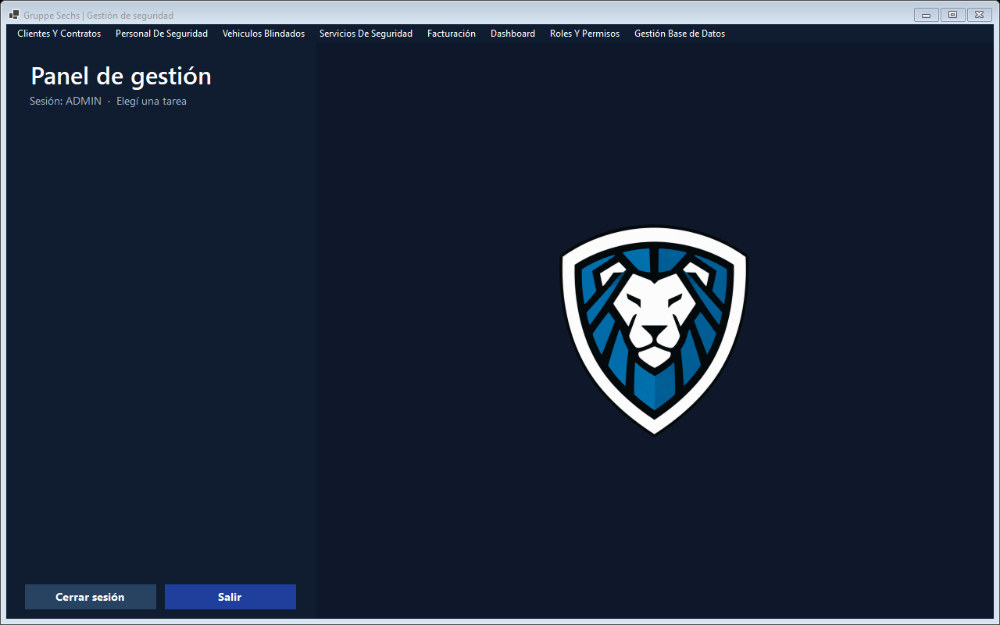
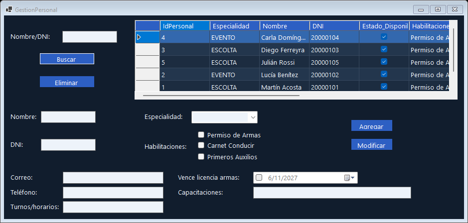
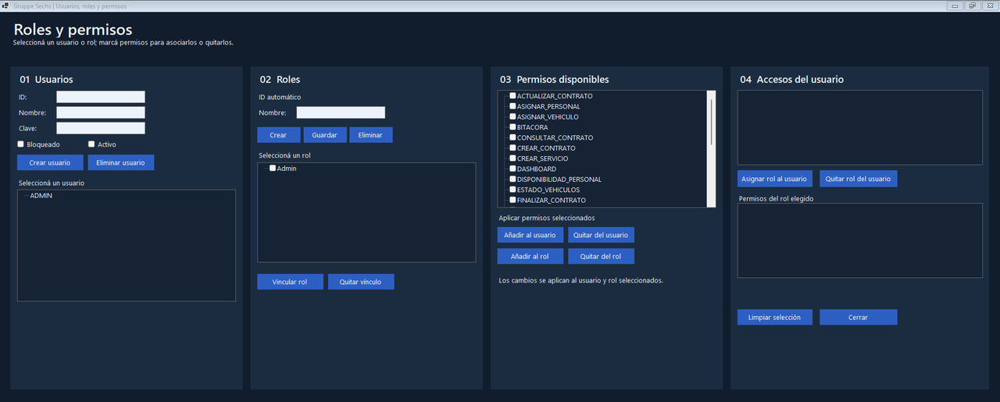

# Sistema de Gestión Gruppe Sechs

[](https://github.com/RenzoLeporace/sistema-gestion-gruppe-sechs/actions/workflows/ci.yml)

Aplicación de escritorio en C# y Windows Forms para gestionar las operaciones de una empresa de seguridad. Centraliza clientes, contratos, servicios, personal, vehículos y facturación en una misma interfaz.

## Funcionalidades

- Registrar clientes y gestionar contratos y servicios.
- Consultar disponibilidad de personal y vehículos, asignar recursos y registrar mantenimientos.
- Generar facturas en PDF, registrar pagos y consultar saldos pendientes.
- Consultar informes operativos y reportes de clientes, recursos e ingresos.
- Administrar usuarios, roles y permisos, consultar la bitácora y realizar copias de respaldo.

## Capturas



<table>
  <tr>
    <td></td>
    <td></td>
  </tr>
  <tr>
    <td align="center"><b>Personal</b> · especialidades, habilitaciones y licencias</td>
    <td align="center"><b>Roles y permisos</b> · acceso por usuario y por rol</td>
  </tr>
</table>

Las capturas usan datos de ejemplo cargados en una base aislada.

## Ejecutar en Windows

Necesitás el SDK de .NET especificado en [`global.json`](global.json). El proyecto usa Windows Forms y almacena los datos localmente en SQLite.

1. Abrí [`Sistema Gestion Gruppe Sechs.sln`](Sistema%20Gestion%20Gruppe%20Sechs.sln) en Visual Studio con la carga de trabajo de escritorio de .NET.
2. Seleccioná `UI` como proyecto de inicio y ejecutalo. La aplicación comienza en la pantalla de inicio de sesión.
3. Iniciá sesión con la cuenta administradora configurada para tu instalación. En el primer acceso, el sistema te pide elegir una contraseña nueva de al menos 8 caracteres.

Desde la raíz del repositorio también podés compilar y ejecutar:

```powershell
dotnet build "Sistema Gestion Gruppe Sechs.sln"
dotnet run --project UI/UI.csproj
```

## Estructura

| Directorio | Responsabilidad |
| --- | --- |
| [`UI/`](UI/) | Formularios de Windows y navegación. |
| [`BLL/`](BLL/) | Reglas de negocio y coordinación de operaciones. |
| [`BE/`](BE/) | Entidades de negocio. |
| [`Mapper/`](Mapper/) | Persistencia SQLite y migración desde XML. |
| [`Seguridad/`](Seguridad/) | Hash de contraseñas con PBKDF2. |
| [`tests/IntegrationChecks/`](tests/IntegrationChecks/) | Comprobaciones de contraseñas, clientes, personal, contratos, facturas, pagos y respaldos. |
| [`docs/`](docs/) | Primera entrega del proyecto en PDF y capturas del README. |

## Seguridad

- Las contraseñas se guardan como hash PBKDF2-HMAC-SHA256, con 600.000 iteraciones y una sal aleatoria por contraseña. No se pueden recuperar: para validar un inicio de sesión se vuelve a calcular el hash y se compara.
- Las contraseñas activas importadas de versiones anteriores, que solo estaban en Base64, se convierten a hash en SQLite al abrir la aplicación o al iniciar sesión con ellas. El XML original queda como copia histórica y debe retirarse de la carpeta Data después de verificar la migración, porque aún contiene los valores antiguos.
- Una contraseña nueva debe tener al menos 8 caracteres y no puede ser igual al nombre de usuario. Las cuentas con una clave inicial deben cambiarla al ingresar.

## Comprobaciones de integración

En Windows, ejecutá:

```powershell
dotnet run --project tests/IntegrationChecks/IntegrationChecks.csproj
```

El ejecutable de pruebas reinicia la carpeta `Data` de su propio directorio de salida. Usalo con datos de prueba.


## Base de datos SQLite

Los datos activos se guardan en Data/gruppe_sechs.sqlite3 junto al ejecutable. La tabla records contiene registros JSON por colección y migrations evita repetir importaciones. Al primer acceso se importan los XML anteriores sin modificarlos. Para actualizar una instalación existente, copiá su carpeta Data junto al ejecutable nuevo antes de abrirlo. Conservá una copia de seguridad hasta verificar la migración.

Los respaldos nuevos son snapshots .sqlite3 consistentes. La restauración valida la integridad y puede crear una copia previa. El backup ZIP incluye la base SQLite. El restaurador actual lista los nuevos snapshots SQLite; los snapshots XML anteriores deben conservarse por separado.

La prueba de integración cubre migración XML, SQLite, roles, usuarios, contratos, servicios, facturación, pagos, respaldos y apertura de formularios con datos aislados.
